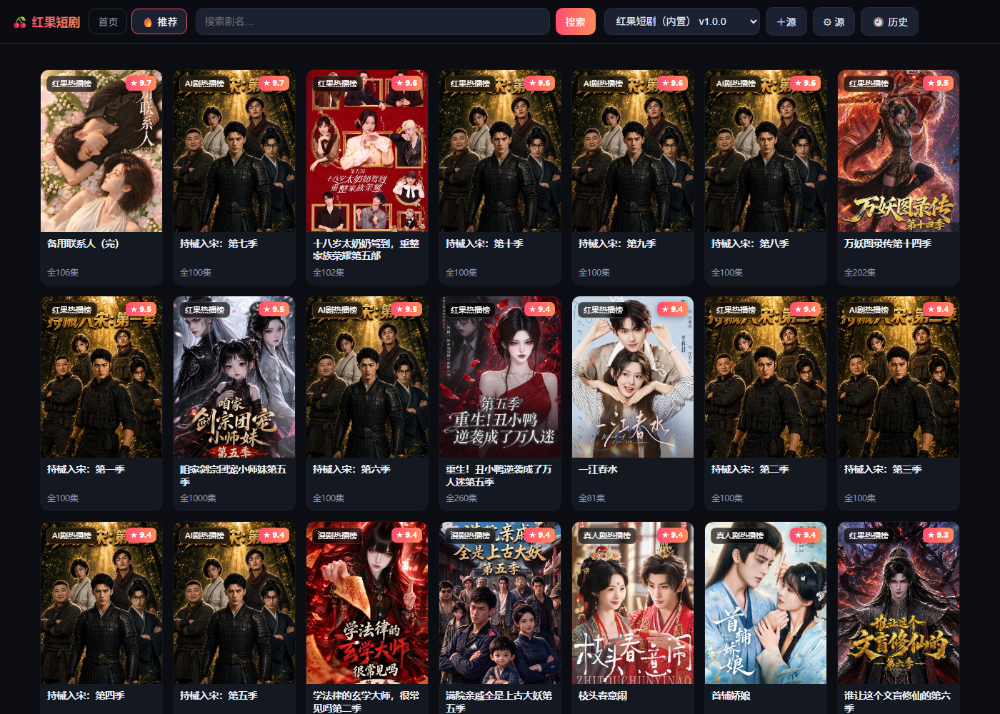
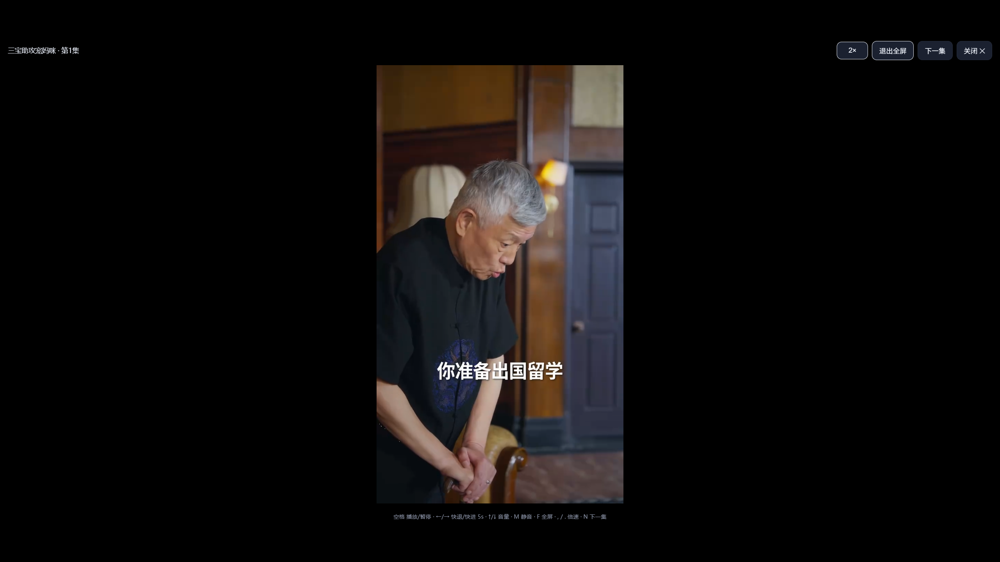

# 红果短剧 · 网页版

<p align="center">
  <a href="https://github.com/kid941005/hongguo-web/actions/workflows/docker.yml"></a>
  <a href="https://github.com/kid941005/hongguo-web/releases"></a>
  <a href="LICENSE"></a>
  <a href="https://github.com/kid941005/hongguo-web/pkgs/container/hongguo-web"></a>
</p>

<p align="center">
  
</p>

<p align="center"><b>把红果短剧搬进浏览器。</b>一个 Docker 容器，内置红果源开箱即用，也兼容糖葫芦（THLRedGuo / CatPaw）格式的单文件 JS 源。</p>

> 仅供个人学习与自用。内容版权归各平台所有，请勿用于商业分发。

---

## 目录

- [它解决什么问题](#它解决什么问题)
- [功能](#功能)
- [截图](#截图)
- [快速开始](#快速开始)
- [部署](#部署)
- [配置](#配置)
- [使用指南](#使用指南)
- [自定义 JS 源](#自定义-js-源)
- [HTTP API](#http-api)
- [架构与目录](#架构与目录)
- [安全说明](#安全说明)
- [已知限制](#已知限制)
- [版本说明](#版本说明)
- [开发与自测](#开发与自测)
- [许可与致谢](#许可与致谢)

## 它解决什么问题

红果的网页端几乎没法直接看：播放地址要现场签名，视频是 CENC 加密，清晰度还混用 HEVC / VVC / H.264 三种编码。本项目把这些麻烦全部收进服务端，浏览器面对的只是一个普通网站。

- **浏览器只跟本服务说话。** 签名取址、CENC 分块解密、Range 转发、HLS 清单重写、VVC / HEVC 转码都在容器里完成，前端拿到的是标准 HLS / MP4。
- **一个站点看全部内容。** 首页、分类、搜索、推荐、猜你喜欢、详情、选集、播放、账号、历史、收藏、追更在同一套界面里，桌面与手机共用一套页面。
- **数据源可扩展。** 内置红果之外，任何符合糖葫芦（THLRedGuo / CatPaw）规范的单文件 JS 源都能导入；支持多源并发聚合搜索与播放失败自动换源。
- **自托管、可加固。** 个人数据存 SQLite，落盘在宿主机 `./hongguo-data`；容器默认非 root、只读根文件系统、丢弃全部 capability。

## 功能

| 模块 | 能力 |
| --- | --- |
| 内置红果源 | 服务端 V5 签名取址（SM3 + x-helios / x-medusa / x-ss-stub）+ CENC 分块解密 + Range 转发；360P H.264、720P VVC 与 1080P HEVC 均由服务端转成 H.264 HLS，按浏览器解码能力自动选档；系列剧支持官方季表切换 |
| JS 源 | 单文件 spider，独立 worker 线程沙箱；网页内导入 / 自检 / 删除 / 自动更新；多源聚合搜索与播放失败换源 |
| 检索与发现 | 首页分类、分类分页、搜索、推荐页（多榜单按真实评分合并）、猜你喜欢（协同过滤 + 相似题材 + 热门兜底）、无限滚动 |
| 播放 | HLS 多码率切档、当前分辨率徽标、倍速首尾循环、全屏、下一集预取、跨集自动连播、播放失败诊断、替代源 |
| 个人数据 | 账号登录、观看历史 / 续播、收藏、追剧提醒、倍速偏好，跨设备同步（SQLite） |
| 界面 | 深色 / 浅色 / 跟随设备三档主题、响应式、手机端菜单抽屉、PWA |
| 运维 | /health、/api/metrics、/api/alerts、缓存清理、访问日志、Webhook 告警、播放通道探针 |
| 质量 | server/selftest.mjs 离线自测（182 断言），CI 构建镜像前先跑；发布冒烟脚本 |

## 截图

| 首页 | 推荐 |
| --- | --- |
|  |  |

| 全屏播放 | 手机端 |
| --- | --- |
|  |  |

## 快速开始

### 前置条件

- Docker Engine 20.10+ 或 Docker Desktop（需要 `docker compose` v2）
- 能访问 ghcr.io 或 Docker Hub。两个仓库的镜像都已公开，直接拉取无需登录；某个仓库拉得慢就换另一个，必要时先 `docker login`

### 三步启动

```bash
git clone https://github.com/kid941005/hongguo-web.git
cd hongguo-web
docker compose up -d
```

首次启动会拉取镜像并创建两样东西：

- 容器：`hongguo-web`
- 本地数据目录：`./hongguo-data`（相对 compose 文件所在目录；账号、历史、收藏、导入的源都在这里，直接可见/可备份）

浏览器打开 <http://localhost:8787> 即可。要换端口不必改文件：`PORT=9000 docker compose up -d`，然后访问 <http://localhost:9000>。

### 确认部署成功

```bash
docker compose ps                 # STATUS 列应显示 healthy
docker compose logs -f            # 实时日志，Ctrl+C 退出
curl -s http://localhost:8787/health
```

正常返回：

```json
{"service":"hongguo-web","ok":true,"version":"0.14.20","active":"hongguo","sources":7,"accounts":true,"tokenRequired":false}
```

也可以跑仓库自带的冒烟脚本（检查健康、源列表、首页、猜你喜欢、通道探针等）：

```bash
BASE=http://127.0.0.1:8787 node server/scripts/smoke.mjs
```

### 升级与卸载

```bash
docker compose pull && docker compose up -d   # 有新镜像时重建，./hongguo-data 保留
docker compose down                           # 停止并删除容器，./hongguo-data 保留
rm -rf ./hongguo-data                         # 彻底清空数据（账号/历史/源全部丢失）

> 从旧版本升级（以前用命名卷 `hongguo-data`）时，数据不会自动搬过来，先迁移一次：
>
> ```bash
> docker compose down
> docker volume ls | grep hongguo-data          # 找到旧卷名，通常是 <目录名>_hongguo-data
> docker run --rm --user root \
>   -v <旧卷名>:/from -v "$PWD/hongguo-data:/to" \
>   --entrypoint sh ghcr.io/kid941005/hongguo-web:latest \
>   -c "cp -a /from/. /to/ && chown -R 1000:1000 /to"
> docker compose up -d
> ```
```

## 部署

### 用现成镜像（推荐）

仓库根目录的 [compose.yaml](compose.yaml) 默认使用 `ghcr.io/kid941005/hongguo-web:latest`（bridge 网络 + ports 映射），并已写好完整的加固选项（read_only、tmpfs /tmp、cap_drop ALL、no-new-privileges、非 root）与常用环境变量注释。换端口、加口令、调并发都改这个文件，改完 `docker compose up -d` 生效；也可以不改文件，直接用环境变量覆盖，例如 `PORT=9000 docker compose up -d`。

需要 host 网络（容器直接用宿主机网络、不做端口映射）时，用同目录的 [compose.host.yaml](compose.host.yaml)，见下文「host 网络模式」。

同一份镜像同步推送到 Docker Hub：`docker.io/kid941005/hongguo-web:latest`，标签与 GHCR 一一对应；ghcr 拉不动时把 image 换成它即可。

### 不克隆代码

任意空目录新建 compose.yaml：

```yaml
services:
  hongguo-web:
    image: ghcr.io/kid941005/hongguo-web:latest
    container_name: hongguo-web
    ports: ["${PORT:-8787}:${PORT:-8787}"]
    environment:
      PORT: "${PORT:-8787}"             # 监听端口，默认 8787
      TOKEN: ""                      # 需要访问口令就填
    volumes: ["./hongguo-data:/app/data"]
    restart: unless-stopped
```

然后 `docker compose up -d`；换端口用 `PORT=9000 docker compose up -d`（上面的 `ports` 与 `PORT` 会一起跟着变）。

### host 网络模式（network_mode: host）

某些 NAS / Linux 主机希望容器直接占用宿主机网络（不走端口映射，避免 Docker 代理层），用 [compose.host.yaml](compose.host.yaml)：

```bash
PORT=9000 docker compose -f compose.host.yaml up -d
# 浏览器打开 http://<宿主机IP>:9000
```

- 该文件里没有 `ports` 段，**监听端口完全由环境变量 `PORT` 决定**（默认 8787）。
- `HOST` 保持 `0.0.0.0` 才能被局域网/公网访问；只给本机用可设 `127.0.0.1`。
- 同一端口只能有一个进程占用，host 模式与默认 bridge 模式不要同时启动（容器名同为 `hongguo-web`）。
- 健康检查仍访问 `http://127.0.0.1:$PORT/health`，host 模式下无需额外配置。
- Docker Desktop（Windows/macOS）的 host 网络能力受版本与平台限制，这类系统建议用默认的 `compose.yaml`。

### 从源码构建

把 compose.yaml 里的 `image:` 注释掉、取消 `build: .` 的注释，然后：

```bash
docker compose up -d --build
```

完全不用 compose 时：

```bash
docker build -t hongguo-web .
docker run -d --name hongguo-web \
  -p 8787:8787 \
  -e PORT=8787 -e HOST=0.0.0.0 \
  -e DATA_DIR=/app/data -e SOURCES_DIR=/app/sources/builtin \
  -e TZ=Asia/Shanghai -e TOKEN= \
  -e MAX_STREAMS=6 -e ALLOW_PRIVATE_MEDIA=0 -e ALLOW_PRIVATE_FETCH=0 \
  -v "$PWD/hongguo-data:/app/data" \
  --restart unless-stopped \
  --read-only --tmpfs /tmp --security-opt no-new-privileges --cap-drop ALL \
  hongguo-web
```

不用 compose 时换端口：把 `-p 8787:8787` 和 `-e PORT=8787` 一起改成同一个端口即可。

想固定版本就把镜像换成 `ghcr.io/kid941005/hongguo-web:0.14.22`（Docker Hub 上同名：`docker.io/kid941005/hongguo-web:0.14.22`）。

### 镜像与标签

| 触发 | 产出标签 |
| --- | --- |
| push main | `:edge` |
| 打 v* 标签 | `:版本号` 与 `:latest`（`:latest` 随最新正式版前移） |
| 手动 workflow_dispatch | `:edge` |

镜像为 linux/amd64 + linux/arm64 多架构；构建前会先跑离线自测。一次构建同时推两个仓库、标签一一对应：

| 仓库 | 地址 |
| --- | --- |
| GitHub Packages | `ghcr.io/kid941005/hongguo-web` |
| Docker Hub | `docker.io/kid941005/hongguo-web` |

构建记录见 Actions。Docker Hub 侧依赖仓库 secrets `DOCKERHUB_USERNAME` 与 `DOCKERHUB_TOKEN`（Access Token，Read & Write）；未配置时 workflow 只推 GHCR，不会失败。

## 配置

所有变量都能写在 [compose.yaml](compose.yaml) 的 environment 里，也可以用同名环境变量覆盖；改完 `docker compose up -d` 生效。

### 常见定制

| 需求 | 做法 |
| --- | --- |
| 换端口（bridge 模式） | 不改文件：`PORT=9000 docker compose up -d`；或把 compose.yaml 里 ports 两侧一起写成目标端口（也支持 `PORT` 环境变量） |
| 换端口（host 模式） | `PORT=9000 docker compose -f compose.host.yaml up -d`，无需 ports |
| 改数据目录 | volumes 左边改成目标路径，如 `/volume1/docker/hongguo-data:/app/data`（默认 `./hongguo-data`） |
| 加访问口令 | environment.TOKEN 填口令。浏览器会直接弹出「需要访问口令」输入框（也可 `http://<host>:8787/?at=<口令>` 打开），填一次记住，之后自动给接口和媒体地址带上 `at=` |
| 放大并发播放 | environment.MAX_STREAMS: `"12"` |
| 低配机器省 CPU | environment.HONGGUO_HEVC_TRANSCODE: `"0"`（关掉 1080P 转码，只给原始 HEVC 直连） |
| 关闭官方 SDK 取址 | environment.HONGGUO_SDK_PLAYBACK: `"0"`（不启用 Python SDK 通道，仅走旧接口与 360P 兼容通道） |
| 允许代理内网媒体 | environment.ALLOW_PRIVATE_MEDIA: `"1"`（默认拒绝，防 SSRF） |
| 改时区 | environment.TZ: `"Asia/Shanghai"` |
| 固定版本 | image 改成 `ghcr.io/kid941005/hongguo-web:0.14.22`，或 Docker Hub 的 `docker.io/kid941005/hongguo-web:0.14.22` |

### 基础

| 变量 | 默认 | 说明 |
| --- | --- | --- |
| PORT | 8787 | 容器内监听端口 |
| HOST | 0.0.0.0 | 监听地址 |
| DATA_DIR | /app/data | 配置、用户源、缓存、账号库（hongguo.db）目录；必须可写，并挂到宿主机目录 |
| SOURCES_DIR | /app/sources/builtin | 内置源目录，镜像自带 |
| TOKEN | 空 | 设置后所有 /api/* 需带 `Authorization: Bearer <TOKEN>` 或 `?at=<TOKEN>`（`?token=` 兼容旧链接）；未设置时管理写接口与 /api/metrics 只接受内网来源 |
| TRUST_PROXY | 空 | 1 时按 X-Forwarded-For 第一跳识别客户端 IP；只在可信反向代理后开启，否则可被伪造 |

### 播放与清晰度

| 变量 | 默认 | 说明 |
| --- | --- | --- |
| MAX_STREAMS | 6 | 内置红果解密流最大并发数 |
| ALLOW_PRIVATE_MEDIA | 空 | 1 时允许 /api/media、/api/hls 代理内网地址（默认拒绝，防 SSRF） |
| ALLOW_PRIVATE_FETCH | 空 | 1 时允许 JS 源 fetch 与按 URL 导入源访问内网地址（默认拒绝，防 SSRF） |
| HONGGUO_DEVICE_ID | 空 | 钉死红果播放通道的匿名设备号（10–20 位纯数字）；不设时首次注册后存 DATA_DIR/device.json 长期复用 |
| HONGGUO_INSTALL_ID | 空 | 配合 HONGGUO_DEVICE_ID 的 install id（10–20 位纯数字） |
| HONGGUO_OFFICIAL_UNSIGNED | 空 | 1 时改用旧的「无签名 + 注册身份」取址请求；仅在上游确已关闭签名校验时使用 |
| HONGGUO_HEVC_TRANSCODE | 1 | 设为 `0` 关闭 1080P（HEVC）的服务端转码：关闭后 1080P 只给原始 HEVC 直连流，设备不支持 HEVC 时会自动回落到 720P 等转码档；低配 NAS 担心 CPU 占用可关 |
| HONGGUO_MODEL_CACHE_MAX | 512 | 官方播放模型缓存条目上限（最小 16） |
| HONGGUO_SDK_PLAYBACK | 1 | 官方 SDK v5 取址通道开关；设为 `0` 关闭（关闭后若上游 App 接口仍空正文，会自动回落 360P 兼容通道） |
| HONGGUO_SDK_TIMEOUT_MS | 45000 | 单次 SDK 取址超时（毫秒） |
| HONGGUO_SDK_CONCURRENCY | 2 | SDK 取址并发上限（每路一个 Python 子进程） |
| HONGGUO_PYTHON | python3 | SDK 子进程使用的 Python 解释器；官方镜像为 `/usr/bin/python3` |
| SDK_CACHE_DIR | `DATA_DIR/sdk-cache` | SDK 素材与匿名设备身份缓存目录；首次播放会在此下载约 5.4MB 素材 |

### 服务端转码

浏览器没有 VVC（H.266）解码器；1080P 是 HEVC、360P 是 H.264，中间几档只有装了 ffmpeg 7.1+ 的服务端转成 H.264 HLS 才能播。相关参数：

| 变量 | 默认 | 说明 |
| --- | --- | --- |
| FFMPEG_PATH | ffmpeg | 服务端转码用的 ffmpeg；官方镜像已装 7.1+，裸机需自行安装 |
| TRANSCODE_MAX_INPUT_BYTES | 100663296 | 单集转码输入上限（默认 96 MB） |
| TRANSCODE_MAX_CONCURRENT | 2 | 同时进行的转码任务上限；槽位排满时先排队等待（见下一行），等不到才返回 503 BUSY |
| TRANSCODE_QUEUE_WAIT_MS | 8000 | 转码槽位排满时最长排队等待毫秒数（默认 8 秒）；设为 `0` 立即返回 503。排队能让「前一个转码刚好收尾」的请求直接接上，不必让前端降清晰度 |
| TRANSCODE_READ_TIMEOUT_MS | 60000 | 单次读取上游的停滞超时（毫秒） |
| TRANSCODE_JOB_TIMEOUT_MS | 600000 | 单个转码任务硬超时（毫秒，最小 60000） |
| HLS_TC_TTL_MS | 1800000 | 转码产物保留时长（默认 30 分钟），到期清理 |
| HLS_TC_IDLE_MS | 60000 | 无人观看时自动取消转码的空闲阈值（毫秒，最小 20000）。播放端 60 秒没有再来取清单/分片就杀掉该转码进程，避免「关了页面 ffmpeg 还在后台把整集转完」 |

### JS 源沙箱

| 变量 | 默认 | 说明 |
| --- | --- | --- |
| SOURCE_WORKER_MAX_OLD_MB | 64 | 每个源线程 V8 老生代上限（MB，最小 32） |
| SOURCE_WORKER_MAX_YOUNG_MB | 16 | V8 新生代上限（MB，最小 8） |
| SOURCE_WORKER_STACK_MB | 4 | 栈上限（MB，最小 2） |
| SOURCE_AUTO_UPDATE | 1 | 启动后自动检查 JS 源上游更新；0 关闭（内置源不参与） |
| SOURCE_UPDATE_INTERVAL_HOURS | 6 | 自动检查间隔（小时，最小 1） |
| SOURCE_UPDATE_START_DELAY_SECONDS | 15 | 启动后首次检查延迟（秒） |

### 通道监控与告警

| 变量 | 默认 | 说明 |
| --- | --- | --- |
| PLAYBACK_MONITOR | 1 | 定时探针检测内置红果通道；0 关闭（/api/alerts 返回 enabled:false） |
| PLAYBACK_MONITOR_INTERVAL_MINUTES | 10 | 探针间隔（分钟，最小 1）；会真实取一集首块并校验 ftyp |
| PLAYBACK_ALERT_THRESHOLD | 3 | 连续失败多少次判定不可用并告警（最小 1） |
| ALERT_WEBHOOK_URL | 空 | 状态翻转时 POST JSON，可接钉钉/飞书/Slack 或自建收集端 |

## 使用指南

### 浏览、搜索与发现

- **顶栏**：桌面端是「外观 / 账号 / 历史 / 源」四组下拉；手机端收进右上角「☰ 菜单」抽屉，点一下展开全部分组，一格一点即达。
- **首页 / 分类**：首页给分类与推荐，分类页分页浏览；首页、分类、搜索、推荐页都支持无限滚动，底部保留「加载更多」兜底。
- **推荐页**：把内置红果四个榜单（热播 / 真人 / 漫剧 / AI）按真实评分合并排序，卡片显示评分。
- **猜你喜欢**：基于观看历史的三路信号合并排序——协同过滤、相似题材、热门兜底；登录后跨设备一致，未登录只用本机历史做种子。
- **搜索**：红果内置源按「官网索引 → App 签名通道 → 首页推荐池」三级降级；官网索引每页 10 条，支持翻页；关键词超过 30 字按前 30 字检索。
- **多源聚合搜索**：源下拉框选「🔎 全部源（聚合搜索）」再搜索，所有可用源并发查询、谁先返回先展示，卡片带源名徽标；顶部提示条显示已返回源数、总条数与各源失败原因。模板与示例源不参与聚合。

### 播放与清晰度

- **选集**：点卡片 → 详情页选集；多线路先选线路。支持 HLS（m3u8）与 MP4 直链；flv 能识别但没有播放器。
- **多季**：内置红果系列剧在详情页显示「季」选择条，观看进度按季独立记录。
- **清晰度**：控制条常显当前解码分辨率徽标。点「清晰度」可查看档位；HLS master 多码率源支持自动 / 各档切换并尽量保持播放位置；单码率 HLS 与 MP4 直链只显示「该源仅此一种清晰度」，不伪造选项。
- **倍速**：0.5×–2× 首尾循环（点 1.0× 前进，逗号键反向），刷新和换集保持。
- **全屏**：按钮 / 双击画面 / F。
- **下一集预取**：接近结尾时后台预取下一集首段，点「下一集」更快。
- **跨集自动连播**：默认开启，可点「连播 开 / 连播 关」关闭；关闭后播完停在当前集并落盘进度。服务端转码是边转边追加分片的 HLS，只有清单出现结束标记才算真的播完；「假结束」只会续播当前集，不会误跳下一集。
- **播放失败排查**：浮层会区分「内容源暂时不可用 / 设备不支持 VVC / 解不了这一档画面 / 地址可用但播放异常」，并给出重试、切 360P 兼容或换源的对应操作。加载慢先提示「网络较慢，正在加载，请稍候…」，真正超时才报错，不会把「慢」误判成「坏」。转码排队时提示「转码排队中，正在重试…」，保持原清晰度重试，不降档。

### 账号与多设备同步

- **账号可选**：顶栏「账号」→ 登录 / 注册（用户名 3–20 位中英文数字下划线，密码 6–64 位）。不登录也能正常看剧。
- **观看历史 / 续播**：进度每 5 秒、暂停、关闭播放器时落盘（上限 100 条）；详情页显示续播条，已看过的集变暗。
- **收藏 / 追剧**：详情页可收藏、追更；追更定时检查集数变化，有新集时显示角标。
- **多设备同步**：历史、收藏、追更、倍速偏好存服务端 SQLite；本地历史与服务端按时间戳取新合并，旧进度不会覆盖新进度。

### 源管理

- **切换源**：顶栏「源」→「目前数据源」。
- **管理面板**：查看版本 / 类型 / 是否使用中，一键启用；「自检」做连通性检查（Shift 点击对内置红果真实取流校验首块 ftyp）；展开最近日志；删除导入源（内置源不可删）。
- **自动更新**：有上游地址的源显示开关；底部「检查源更新」可立即检查全部；更新失败保留旧版本并记录原因。
- **导入源**：「源」→「＋ 新增」，粘贴 HTTPS 源地址或直接粘贴 JS 源码；导入后先跑一次 home 自检，失败不保存。

### PWA 与快捷键

Chrome / Edge 地址栏会出现「安装」；手机浏览器「添加到主屏幕」后以独立窗口运行。Service Worker 需要安全上下文（https:// 或 http://localhost），局域网纯 HTTP 可用但没有离线缓存。常驻窗口回到前台时会比对服务端版本，发现新版本自动整页刷新。

| 按键 | 作用 |
| --- | --- |
| 空格 / K | 播放 / 暂停 |
| ← / → | 后退 / 前进 5 秒 |
| ↑ / ↓ | 音量 ±10% |
| M | 静音切换 |
| F | 全屏 / 退出全屏 |
| , / . | 减速 / 加速（0.5×–2× 循环） |
| N | 下一集 |

快捷键在播放器打开时生效；焦点在输入框里时不拦截。

### 深链

```text
/?rec=1                                  推荐页
/?foryou=1                               猜你喜欢
/?source=qimao                           指定源
/?source=__all&q=总裁                    聚合搜索
/?source=qimao&id=5207                   剧集详情
/?source=qimao&id=5207&ep=0              直接播放第 1 集（从 0 计数）
```

## 自定义 JS 源

源是单个 .js 文件，声明一个全局 spider 对象。每个源跑在独立的 worker_threads 线程里（默认 64 MB 内存上限），只通过消息通道拿到 fetch，碰不到 require / process / 文件系统等 Node API。

```js
var spider = {
  id: "my_source",                 // 唯一 id
  name: "我的源",                   // 显示名
  version: "1.0.0",                // 可选；给了就必须是 x.y.z
  updateUrl: "https://example.com/my_source.js", // 可选；HTTPS 上游地址

  home: function (filter, isFirst) {
    return {
      class: [{ type_id: "1", type_name: "全部" }],
      list: []                     // 可省略，服务端会用第一个分类兜底
    };
  },

  category: function (tid, page, filter, extend) {
    const list = [{
      vod_id: "id1",
      vod_name: "剧名",
      vod_pic: "https://…",
      vod_remarks: "更新至10集"
    }];
    const hasMore = list.length > 0;
    return { page: page, pagecount: hasMore ? page + 1 : page, hasMore: hasMore, list: list };
  },

  detail: function (id) {
    return {
      list: [{
        vod_id: id,
        vod_name: "剧名",
        vod_tag: "都市/甜宠",       // 可选，多个用 / 分隔
        vod_play_from: "线路A",     // 多个用 $$$
        vod_play_url: "第1集$ep1#第2集$ep2" // 集用 #，集名与集 ID 用 $
      }]
    };
  },

  search: function (wd, quick, page) {
    const list = [];
    const hasMore = false;
    return { page: page, pagecount: hasMore ? page + 1 : page, hasMore: hasMore, list: list };
  },

  play: function (flag, id, flags) {
    return "https://example.com/stream.m3u8"; // 或 { url, header }
  }
};
```

要点：

- 有网可用 `await fetch(url, { headers, timeoutMs })`；`html.parse(...)` 可用（支持 tag、.class、#id、tag.class、空格后代选择器）。
- updateUrl 必须是 HTTPS 且返回同一个 id 的源；更新前会跑一次 home + 首条详情自检，失败保留旧版本。按 URL 导入时即使 meta 没写 updateUrl，也会用导入地址作为上游。
- play 必须返回可直连的 m3u8 / mp4；flv 能识别但没有播放器。返回 `parse: 1`（需要 webview 嗅探）本服务不支持，会报「需要 webview 嗅探解析」。
- 分页建议返回 `pagecount: hasMore ? page + 1 : page`，并明确 hasMore；写死 page + 1 会让前端无限翻页。
- 除核心方法外还可选实现 feed / rankings / recommendations / rankingBoards / seriesSeasons / danmaku 等；目前对 JS 源只调用核心方法，内置红果的季表由服务端自行实现。
- 不得 import / require，不得访问 Node 内置模块或文件系统。

## HTTP API

所有错误统一返回 `{ error, code }`。个人数据接口需登录并带 `X-Auth-Token`；应用级 TOKEN 支持 `Authorization: Bearer` 或 `?at=`。

### 基础与运维

| 方法 | 路径 | 说明 |
| --- | --- | --- |
| GET | /health | 健康检查（含 accounts 是否启用账号系统、tokenRequired 是否需要口令） |
| GET | /api/metrics | 运行指标：uptime、RSS、取流尝试/失败/空响应、熔断、去重、通道计数、转码任务、官方设备状态 |
| GET | /api/alerts | 通道监控快照：status（ok / degraded / down / unknown）、失败次数、最近告警 |
| POST | /api/alerts/check | 立即跑一次通道探针 |
| POST | /api/cache/clear | 一键清缓存：首页 SWR、推荐池、vendor 缓存与官方播放模型缓存 |

### 认证与个人数据

| 方法 | 路径 | 说明 |
| --- | --- | --- |
| POST | /api/auth/register | 注册：{ username, password } → { token, user } |
| POST | /api/auth/login | 登录：同上 |
| POST | /api/auth/logout | 注销当前令牌 |
| GET | /api/auth/me | 当前用户 |
| GET/PUT/DELETE | /api/me/history | 云端观看历史：列表 / 上报一条 / 清空 |
| DELETE | /api/me/history/:source/:id | 删除一条历史 |
| GET/POST | /api/me/favorites | 收藏列表 / 新增 |
| DELETE | /api/me/favorites/:source/:id | 取消收藏 |
| GET/POST | /api/me/follows | 追剧列表 / 新增 |
| DELETE | /api/me/follows/:source/:id | 取消追剧 |
| GET | /api/me/follows/updates?force=1 | 检查追更（默认 10 分钟节流） |
| GET/PUT | /api/me/prefs | 个人偏好（播放倍速） |

### 源管理

| 方法 | 路径 | 说明 |
| --- | --- | --- |
| GET | /api/sources | 源列表 + 当前启用源 |
| POST | /api/sources/import | 导入源：{ url } 或 { code } |
| POST | /api/sources/active | 切换启用源：{ id }（普通操作，不按管理写拦截） |
| GET | /api/sources/:id/log | 源最近运行日志 |
| GET | /api/sources/:id/health | 源健康检查；?deep=1 时内置红果走 home→detail→stream 真实取流 |
| DELETE | /api/sources/:id | 删除用户源（内置源不可删） |
| POST | /api/sources/check-updates | 立即检查所有可自动更新的 JS 源 |
| POST | /api/sources/:id/check-update | 立即检查单个源更新 |
| POST | /api/sources/:id/auto-update | 开关单个源自动更新：{ enabled: true } |

### 内容与播放

| 方法 | 路径 | 说明 |
| --- | --- | --- |
| GET | /api/home?source=&page= | 首页（classes + items），带 SWR 语义（stale / age） |
| GET | /api/recommend?page= | 推荐页：四榜单按真实评分合并排序 |
| POST | /api/for-you | 猜你喜欢：{ seeds?, refresh? }；登录用户用云端历史做种子 |
| GET | /api/category?source=&tid=&page= | 分类列表 |
| GET | /api/search?source=&q=&page= | 搜索；source=__all（或 all=1）为多源聚合 |
| GET | /api/detail?source=&id= | 详情（标签、线路、剧集；内置红果系列剧带 seasons） |
| GET | /api/play?source=&flag=&id= | 取播放地址（{ type, url }；内置红果带 quality） |
| GET | /api/play/fallback?source=&id=&index= | 播放失败时的替代源，最多 3 个候选 |
| GET | /api/media?u=&r=&at= | 媒体透传（支持 Range，r 为 Referer） |
| GET | /api/hls?u=&r=&at= | HLS 清单重写（分片走 /api/media；重写出的子清单/分片地址自动带上同一 at） |
| GET/HEAD | /api/stream/:epId?q=&at=&vvc= | 内置红果分集流（服务端解密 + Range）；q 支持 auto / 1080p / 720p / 540p / 480p / 360p / compat |
| GET | /api/tc/:epId/:q/index.m3u8 | 内置红果 VVC / HEVC 档的服务端 HLS 转码清单 |
| GET | /api/tc/:epId/:q/:file | 转码清单里的 init.mp4 / seg_NNNNN.m4s（支持 Range） |

### 错误码与日志

常见 code：BAD_INPUT / BAD_JSON / BAD_URL（400）、UNAUTHORIZED / TOKEN_REQUIRED（401，后者=站点访问口令未填或不对）、PROTECTED（403）、NOT_FOUND（404）、USER_EXISTS（409）、CODEC_UNSUPPORTED（415）、RATE_LIMITED（429）、BUSY / UPSTREAM_COOLDOWN / UPSTREAM_EMPTY（503）、TIMEOUT（504），其余上游问题 502。凡「过一会儿再来」的码都带 Retry-After。

访问日志：每个 /api/* 请求与失败的静态请求写一条 `{"event":"access",method,path,status,ms}`；静态资源 200 不记，避免刷屏。

## 架构与目录

```text
hongguo-web/
├─ Dockerfile / compose.yaml / .dockerignore
├─ LICENSE
├─ .github/workflows/docker.yml     # 构建并推送 GHCR + Docker Hub：main→:edge，tag→:版本+:latest
├─ docs/                            # research.md + screenshots/
├─ server/
│  ├─ index.mjs                     # 入口：装配 provider + 源管理 + 目录 + HTTP + 监控
│  ├─ provider.mjs                  # 内置红果取流编排 + 熔断
│  ├─ official.mjs                  # V5 签名取址、设备身份、档位解析
│  ├─ vendor/hongguo.cjs            # 红果解析核心（drpys 派生，GPL）
│  ├─ breaker.mjs                   # 上游熔断状态机
│  ├─ device.mjs                    # 设备身份持久化与轮换
│  ├─ catalog.mjs                   # 内置源与 JS 源归一成同一套 API
│  ├─ media.mjs                     # /api/media 透传 + /api/hls 重写
│  ├─ stream.mjs                    # /api/stream 解密流（Range、并发、去重）
│  ├─ transcode.mjs                 # VVC / HEVC → H.264 转码核心
│  ├─ hls-tc.mjs                    # 转码档 HLS 任务与排队
│  ├─ monitor.mjs                   # 播放通道探针与告警
│  ├─ recommend.mjs                 # 推荐 / 猜你喜欢排序
│  ├─ db.mjs / users.mjs            # SQLite 与用户数据
│  ├─ http.mjs                      # 路由、鉴权、访问日志
│  ├─ selftest.mjs                  # 离线自测（182 断言）
│  ├─ scripts/smoke.mjs             # 发布冒烟
│  └─ sources/                      # JS 源运行时、沙箱、管理
├─ sources/builtin/                 # qimao / xifan / xingya / niuniu / template / maccms（红果是内置伪源，由 provider 提供）
└─ web/                             # 前端静态页 + hls.js + PWA
```

技术栈：前端原生 JS + hls.js；后端 Node.js ESM（Node ≥ 22.13，用到 node:sqlite）；数据 SQLite；容器 node:22-trixie-slim + ffmpeg 7.1。

## 安全说明

- **访问口令**：公网部署务必设置 TOKEN。设了之后页面会弹「需要访问口令」输入框（PWA 从桌面图标打开也能填），也可用 `?at=<TOKEN>` 打开；填一次记住，之后接口与媒体地址自动带参。入口在「账号 → 🔑 口令」，可改可清。
- **未设 TOKEN 时的管理接口**：源导入/删除/更新/自检/日志、清缓存、告警检查、`/api/metrics` 只接受内网来源；「切换当前源」是普通操作，不受此限制（顶栏下拉框人人可点）。
- **反向代理**：只有确认前面是可信代理时才设 TRUST_PROXY=1，否则 X-Forwarded-For 可被伪造。
- **SSRF**：默认禁止代理内网媒体、禁止 JS 源访问内网；确有需要再分别打开 ALLOW_PRIVATE_MEDIA / ALLOW_PRIVATE_FETCH。
- **JS 源沙箱**：每源独立 worker_threads，有内存与超时限制，拿不到 Node API；但源代码仍由你导入，请只安装可信来源。
- **容器加固**：官方 compose 默认 read_only、tmpfs /tmp、cap_drop ALL、no-new-privileges、非 root 运行。

## 已知限制

- **内置红果搜索**：主通道是官网搜索 JSON 接口；失败才降级首页推荐池检索（fallback:true、结果不全）。
- **需要 webview 嗅探的源（parse: 1）不可用**：本服务没有浏览器内核。
- **同时播放上限**：内置红果解密流默认 6 路并发（MAX_STREAMS 可调）；同一集同一档位多人同时点开只取址一次。
- **红果档位与编码**：360P 是 H.264；1080P 是 HEVC、360P–720P 中间档是 H.266/VVC，浏览器都没有解码器，只有服务端装了 ffmpeg 7.1+ 才转成 H.264 HLS（1080P 转码可用 `HONGGUO_HEVC_TRANSCODE=0` 关闭，关闭后 1080P 只给 HEVC 直连，设备不支持则回落低档）。转码约 12× 实时（单核），并发多了会排队；排队等不到会返回 503 并让前端原档重试。
- **红果加密格式**：只支持 CENC（AES-128-CTR）、每样本 8 字节 IV、无 subsample、moov 前置的非分片 MP4；上游若改格式会返回 CENC_UNSUPPORTED，而不是花屏。
- **官方取址（旧 HTTP 签名链）会被限流**：2026-11 起纯 HTTP 签名对匿名设备返回 200 空正文；本服务优先走官方 SDK v5 通道（需要 Python3 + unicorn + pycryptodome，官方镜像已内置），SDK 失败才回旧链，旧链的空正文 / 403 / 429 会进入冷却并回落 360P。
- **SDK 首次取址较慢**：第一次播放要下载约 5.4MB 官方 SDK 素材到 `DATA_DIR/sdk-cache`，约多花 3–5 秒；之后每集取址 1.5–3 秒。缓存被删除后会重新下载。
- **Windows Docker Desktop 取址限制**：部分 Windows Docker Desktop（WSL2 NAT）环境无法完成到 `log.snssdk.com` 的 TLS 握手，首次 SDK 设备注册会失败，表现为只能 360P；Linux/NAS 原生 Docker 无此问题。可把一份可用实例的 `sdk-cache/device.json`（以及同目录的 `libmetasec_ml.so`、`sdk-app-config.encoded`）复制到 `DATA_DIR/sdk-cache` 后重启；本项目本机 8787 即用此法恢复 1080P。
- **替代源依赖同名剧**：按标题相似度跨源匹配；红果独播剧、译名差异大的剧通常找不到候选。
- **账号数据库**：DATA_DIR/hongguo.db；必须挂到本地目录，备份直接拷这个文件（建议先停容器）。
- **PWA**：Service Worker 只在 https:// 或 http://localhost 启用；局域网纯 HTTP 可用但没有离线缓存、不能安装。
- **清晰度取决于源**：只有提供 master playlist 的 HLS 源才有档位可切；单码率 HLS 与 MP4 直链只有一项。
- **推荐页首次加载慢**：需要抓四个榜单共 20 页（约 10 秒），结果缓存 10 分钟。
- **聚合搜索耗时**：各源并发、先回先展示；单源上限 12 秒（内置红果 30 秒），超时只丢该源并在提示条注明。
- **JS 源沙箱**：默认 64 MB 内存上限；死循环/超时/内存超限自动终止该源线程，下次调用自动重启。
- **源自动更新**：只对 HTTPS 上游的用户 JS 源生效；内置源随镜像升级，不参与自动更新。

## 版本说明

最新发布见 [Releases](https://github.com/kid941005/hongguo-web/releases)。main 对应 `:edge`；正式版本打 v* 标签并同时推 `:版本号` 与 `:latest`。
- **v0.14.22**：修复「红果播放通道不可用：分集数据异常」。2026-11 起官网详情页对匿名访客只返回前 5 集，且分集 ID 从纯数字换成不透明的 `v1_...` 字符串；旧校验一律判为「分集数据异常」，所有红果剧详情 502。本版改为**App 签名分集接口优先**（`/novel/player/video_detail/v1/`，复用匿名设备身份与签名链，空正文自动换身份重试一次），拿到完整分集（实测 96/78 集）与纯数字 vid；官网 5 集仅作兜底，并放开 `v1_` ID 的详情解析与 `/api/stream` 直链播放。实测《少夫人来自东北3》第 1/96 集均为 1080P 起播、Range 206，桌面与移动端回归通过。
- **v0.14.21**：修复官方高清取流。上游把 App 取址接口（video_tab / multi_video_model）对匿名设备一律返回 HTTP 200 空正文，导致官方通道熔断、整站回落到 360P 兼容通道。本版新增**官方 SDK v5 取址通道**：匿名设备注册 → 下载并校验官方 SDK 素材（首次约 5.4MB，缓存到 `DATA_DIR/sdk-cache`）→ 本地模拟 SDK 计算签名 → 换取 token → 调播放接口拿 1080P/720P 的 HEVC 流与内容密钥，再由现有解密/转码链路输出。实测 1080P/720P/540P/480P/360P 全部恢复；首次播放需下载素材，起播约 6–8 秒，之后每集起播约 3–4 秒。可用 `HONGGUO_SDK_PLAYBACK=0` 关闭。 本机 8787 容器已升级到该版本（`docker compose up -d` 后 `/health` 报 `0.14.21`，桌面与移动端播放回归 28/28 通过）。
- **v0.14.20**：数据目录改为本地 bind 挂载。默认 compose 的 `volumes` 从命名卷 `hongguo-data:/app/data` 改为 `./hongguo-data:/app/data`，账号库/历史/收藏/导入的源直接落在宿主机当前目录，方便查看与备份（README 升级章节已附旧卷迁移命令）；`compose.host.yaml` 同步改为 `./hongguo-data:/app/data`。 本机 8787 容器已升级到该版本（数据已从旧命名卷 `app_hongguo-data` 迁移到 `app/hongguo-data`，`/health` 报 `0.14.20`，状态 healthy）。
- **v0.14.19**：部署方式增强。① 端口改为环境变量驱动：`PORT=9000 docker compose up -d` 即可换端口（bridge 模式下 ports 两侧同步跟随 `PORT`），无需改文件。② 新增 [compose.host.yaml](compose.host.yaml)：`network_mode: host`，不写 ports，监听端口只由 `PORT` 决定，适合 NAS / Linux 主机直连宿主机网络；健康检查同样按 `PORT` 探测。 本机 8787 容器已升级到该版本（`docker compose up -d` 后 `/health` 报 `0.14.19`，状态 healthy）。
- **v0.14.18**：清晰度默认值修正。取消 v0.14.17 的「默认档位自适应」——不再按手机/核数/网络把默认清晰度降到 720P/540P，默认始终是「自动（最高，1080P）」，仅在最高档本机无法解码时才退到本机可播的最高档；自动降档只在解码失败时发生。v0.14.17 的边下边转（P0-1）与空闲自动取消（P0-2）保持不变。 本机 8787 容器已升级到该版本（`docker compose up -d` 后 `/health` 报 `0.14.18`，状态 healthy）。
- **v0.14.17**：起播与卡顿优化（P0-1/P0-2/P0-3）。① **边下边转**：以前要先把整集（1080P 7–10 MB）下载完才开始转码，冷启动首帧动辄 8 秒；现在只预读 moov（约 1 MB）就启动 ffmpeg，剩下的 mdat 边下边喂给它，实测 1080P 首个分片 8.0s → 2.0s、720P 2.7s → 2.0s。② **空闲自动取消**：播放端 60 秒不再取清单/分片就自动杀掉转码（`HLS_TC_IDLE_MS`），修复「页面关了 ffmpeg 还在空转、把并发槽位占满」。③ ~~默认档位自适应~~：曾按设备限制默认档（手机 720P、≤4 核 540P），该行为已在 **v0.14.18 取消**，默认始终最高档。 本机 8787 容器已升级到该版本（`docker compose up -d` 后 `/health` 报 `0.14.17`，状态 healthy）。
- **v0.14.16**：文档版。整份重写 README：章节重组、配置拆成「基础 / 播放与清晰度 / 服务端转码 / JS 源沙箱 / 通道监控与告警」六组，修正内置源清单位置与 HEVC / VVC 转码说明，版本说明恢复时间倒序并对齐 GHCR + Docker Hub 双仓库发布。功能与 v0.14.15 完全一致。 本机 8787 容器已升级到该版本（`docker compose up -d` 后 `/health` 报 `0.14.16`，状态 healthy）。

- **v0.14.15**：修复「一集没播完就自动跳下一集、并且画质被降」。服务端转码出的 HLS 是**边转边追加分片**的 EVENT 清单，`video.duration` 会一路变长；播放器此前用「当前时间接近 duration」判断片尾，于是转码刚产出 3–4 秒时就误判播完，直接切下一集（连播开着时表现为疯狂跳集），切集又会打断刚建立的转码而回落到低档。现在改为：清单里出现 `EXT-X-ENDLIST`（`details.live === false`）之后才允许片尾判定，转码期间 `ended` 事件只续播不切集。另外把「转码槽位排满」从立即 503 改为**先排队最多 8 秒**（`TRANSCODE_QUEUE_WAIT_MS`），并让前端遇到 503/429 时**原档重试**而不是降清晰度，避免一次排队把整部剧永久压到 540P。 发版前实测：红果 1080P 连续播放 130 秒始终停在第 1 集、画质保持 1080P、无 JS 错误。
- **v0.14.14**：修复红果官方高清通道（2026-11-20 起 v5 POST 与旧签名 GET 都只回 200 空正文，导致长期只能 360P 兼容）。改用同族 `video_tab` **无正文 GET** 签名请求（`/reading/bookapi/video_tab/multi_video_model/v1/`，按空 body 计算 stub，不再发 req-ticket），恢复 1080P/720P/540P/480P/360P 全档取址；1080P 为 HEVC，普通浏览器解不了，故新增服务端转码（HEVC → H.264 HLS 分片，可拖动，限 2500kbps），默认开启，可用 `HONGGUO_HEVC_TRANSCODE=0` 关闭。 发版后官方通道探测恢复 `status: ok / channel: official`。
- **v0.14.13**：发布流程变更——同一份镜像在推送 GHCR 的同时同步推送到 Docker Hub（`docker.io/kid941005/hongguo-web`），标签与 GHCR 完全一致；workflow 未配置 Docker Hub secrets 时自动跳过、只推 GHCR。功能与 v0.14.12 完全一致。
- **v0.14.12**：修复「播放加载超时」误报。原来起播 8 秒没画面就弹「播放加载超时（8 秒未响应），可能是当前数据源受限」，冷启动转码或 NAS 上行较慢时（720P 服务端转码首块常见 8–15 秒）会把「慢」误判成「坏」。现在分两级：8 秒还没数据只在底部提示「网络较慢，正在加载，请稍候…」，HLS / 服务端转码 25 秒、直连 15 秒仍收不到任何数据才弹错误横幅；期间只要拿到元数据或缓冲数据就自动撤销监测。同时修复换集 / 切清晰度 / 深链自动起播时 `play()` 被新 load 取代抛出的 `AbortError` 被当成「播放失败」弹出的误报。发版前桌面/移动端播放回归 26/26 通过。
- **v0.14.11**：新增「访问口令门」：设了 TOKEN 的实例打开页面先弹口令输入框（首页不再刷成一屏 401），口令填对即记住并自动重载；登录/注册被口令拦住时提示「本站需要访问口令」并引导填写；菜单「账号 → 🔑 口令」可随时重填或清除。服务端 `/health` 增 `tokenRequired` 字段，口令失败改用独立业务码 `TOKEN_REQUIRED`（仍是 401），前端据此区分「站点要口令」与「账号登录态失效」。
- **v0.14.10**：`/api/sources/active` 不再按管理写拦截：切换当前源属于普通操作（不执行脚本），未设 TOKEN 的公网反代部署下前端切源不再 403；源导入/删除/更新/自检/日志仍只对内网开放。
- **v0.14.9**：全项目审计修复：设 TOKEN 时 JS 源 HLS 子清单/分片请求 401、`HEAD /api/media` 上游连接悬挂、`/api/play` 响应泄漏源侧 headers 与上游直链、写接口非对象 body 报 500、追更失败无退避与集数抖动误报、JS 源 URL 垫片不保真、历史封面不走代理、历史弹窗文案、Service Worker 缓存 `/health`、`engines` 版本与重复 CSS。
- **v0.14.8**：PWA 版本探测：窗口回到前台或重新获得焦点时比对 `/health` 与服务端版本，发现新版本自动整页刷新，常驻 PWA 不再停留在旧界面。
- **v0.14.7**：手机播放器工具条重排：4 列网格换行，取消横向滚动，关闭/下一集始终可见；≤420px 小字号，≤340px 三列且关闭独占一行；手机端清晰度按钮去掉括号说明。
- **v0.14.6**：倍速按钮改为首尾循环，2× 后可回到 0.5× 并继续到 1×；未知倍速归一到 1×。
- **v0.14.5**：手机端顶栏收进「菜单」抽屉，顶栏高度 166→138px；抽屉内分组直出、42px 大按钮，≤370px 两列。
- **v0.14.4**：全项目审计修复：转码看门狗与任务硬超时、内置源防覆盖、无 TOKEN + 反代鉴权加固、官方取址冷却与缓存上限、设备身份持久化等。
- **v0.14.3**：红果官方取址改用 V5 签名（SM3 + x-helios / x-medusa / x-ss-stub），恢复 720P 转码 / 1080P HEVC 档位。
- **v0.14.2**：带签名的 video_tab 取址 + 平台匿名一次性设备身份。
- **v0.14.1**：镜像换 node:22-trixie-slim + ffmpeg 7.1，新增 VVC → H.264 服务端转码。

## 开发与自测

改密钥派生、分块解密、播放签名这类「改一行就可能让所有播放失效」的代码前后，先跑离线自测（不联网、不读 data/）：

```bash
docker run --rm -v "$PWD":/w -w /w node:22-trixie-slim sh -c \
  "corepack enable && pnpm --prefix server install --prod --frozen-lockfile && node server/selftest.mjs"
```

本机有 Node 22.13+ 时也可以（node:sqlite 在 22.5–22.12 仍需 --experimental-sqlite）：

```bash
pnpm --prefix server install --prod --frozen-lockfile
node server/selftest.mjs
```

黄金向量钉住的是「当前已验证行为」：上游 vendor 换算法时它会失败，这是预期——先人工确认新算法，再更新向量。

发布冒烟：

```bash
BASE=http://127.0.0.1:8787 node server/scripts/smoke.mjs
```

## 许可与致谢

- 本项目代码：[GPL-3.0-only](LICENSE)。
- server/vendor/hongguo.cjs 派生自 [drpys](https://github.com/drpys) 的实现，遵循 GPL；详见 server/vendor/LICENSE.drpys、LICENSE.template-tv、NOTICE.md。
- 上游调研与可行性验证过程见 [docs/research.md](docs/research.md)。
- 感谢糖葫芦（THLRedGuo / CatPaw）的 JS 源格式，以及所有上游开源实现。
